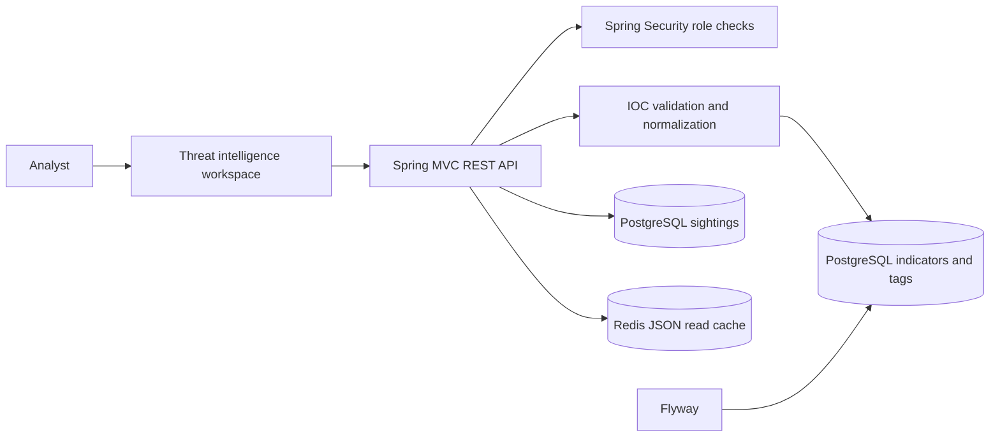
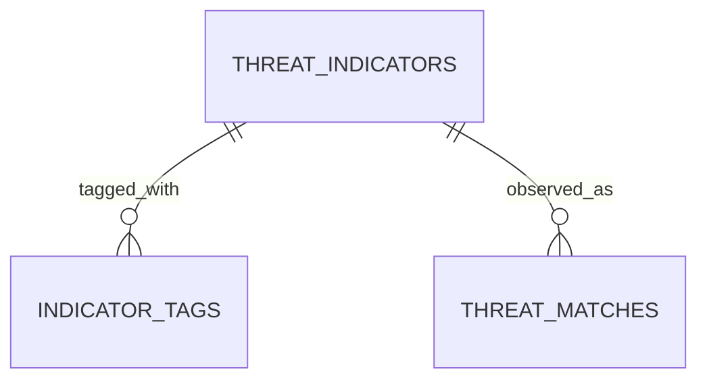

# ThreatLens

ThreatLens is an independently deployable defensive threat-intelligence application for collecting, validating, and investigating indicators of compromise (IOCs). It demonstrates canonical IOC handling, source confidence, expiration, ATT&CK references, and evidence-linked sightings without contacting live infrastructure.

## Product Design

The intelligence workspace combines a searchable indicator collection, analyst intake form, confidence/ATT&CK metadata, and a sightings timeline. It is built for triage and evidence inspection rather than live enrichment. The dashboard is served by Spring Boot and uses same-origin REST requests.

## Technical Features

- Java 21, Spring Boot 3.5, Gradle 9.7.1 wrapper.
- PostgreSQL with an isolated `threatlens` database and `threatlens_app` owner role.
- Flyway migrations for indicators, tags, and observed matches.
- Validation and canonicalization for IPv4, domains, HTTP(S) URLs, SHA-256, and email indicators.
- Database uniqueness constraint on normalized `(type, value)` pairs.
- Password-protected Redis JSON caches for indicator and match reads, with a 30-second TTL.
- Spring Security HTTP Basic roles: `ADMIN`, `ANALYST`, and `VIEWER`.
- Actuator health, Prometheus metrics, non-root Docker image, local Compose stack, CI, Dependabot, and Testcontainers coverage.
- Seeded values use documentation-only IP space and the reserved `.example` domain.

## Architecture





IOC type/value uniqueness is enforced in PostgreSQL in addition to service validation. URL normalization lowercases scheme/host, removes default ports and fragments, and rejects user-info credentials.

## Run With Docker

Requirements: Docker Desktop with the Linux container engine enabled. From this repository's root:

```powershell
Copy-Item .env.example .env
docker compose up --build
```

Open [http://localhost:8083](http://localhost:8083). This project starts only its own PostgreSQL and Redis containers. Their loopback developer ports are `5435` and `6383`. Stop with `docker compose down`; named volumes retain data. `docker compose down -v` removes local data.

## Build, Test, And Run Locally

Requirements: JDK 21. Start only this repository's database and cache:

```powershell
Copy-Item .env.example .env
docker compose up -d postgres redis
```

From the project root, run tests and build the executable JAR:

```powershell
& (Join-Path $PWD 'gradlew.bat') --no-daemon clean test bootJar
```

Start the service in its own terminal:

```powershell
& (Join-Path $PWD 'gradlew.bat') bootRun
```

Or run the packaged application:

```powershell
java -jar build/libs/threatlens-0.1.0.jar
```

## Local Accounts And API

Default local-only accounts (override passwords in `.env`):

| Role | Username | Default password | Permissions |
| --- | --- | --- | --- |
| Admin | `admin` | `local-admin-change-me` | Read, create indicators, Prometheus |
| Analyst | `analyst` | `local-analyst-change-me` | Read and create indicators |
| Viewer | `viewer` | `local-viewer-change-me` | Read-only |

The app connects as `threatlens_app`, which owns only this project's database. The default local role password is `local-threatlens-change-me`. Dashboard credentials stay in tab-scoped session storage.

```powershell
curl.exe -u viewer:local-viewer-change-me http://localhost:8083/api/v1/indicators
```

| Method | Endpoint | Role |
| --- | --- | --- |
| `GET` | `/api/v1/indicators` | Viewer or higher |
| `GET` | `/api/v1/matches` | Viewer or higher |
| `POST` | `/api/v1/indicators` | Analyst or admin |
| `GET` | `/actuator/health` | Public health status |
| `GET` | `/actuator/prometheus` | Admin |

Example `POST /api/v1/indicators` body:

```json
{
  "type": "DOMAIN",
  "value": "suspicious.example",
  "source": "Analyst submission",
  "confidence": 60,
  "techniqueId": "T1071",
  "techniqueName": "Application Layer Protocol",
  "tags": ["review"]
}
```

## CI And Safety

`.github/workflows/ci.yml` runs Gradle tests/build and builds this repository's Docker image. `.github/dependabot.yml` tracks Gradle, Docker, and Actions updates. See [SECURITY.md](SECURITY.md) for reporting and deployment guidance.

The app never polls external feeds, performs enrichment lookups, or contacts submitted observables. Demo credentials and HTTP Basic are local-only; use TLS and OIDC for real deployments. Do not expose this service to an untrusted network.
